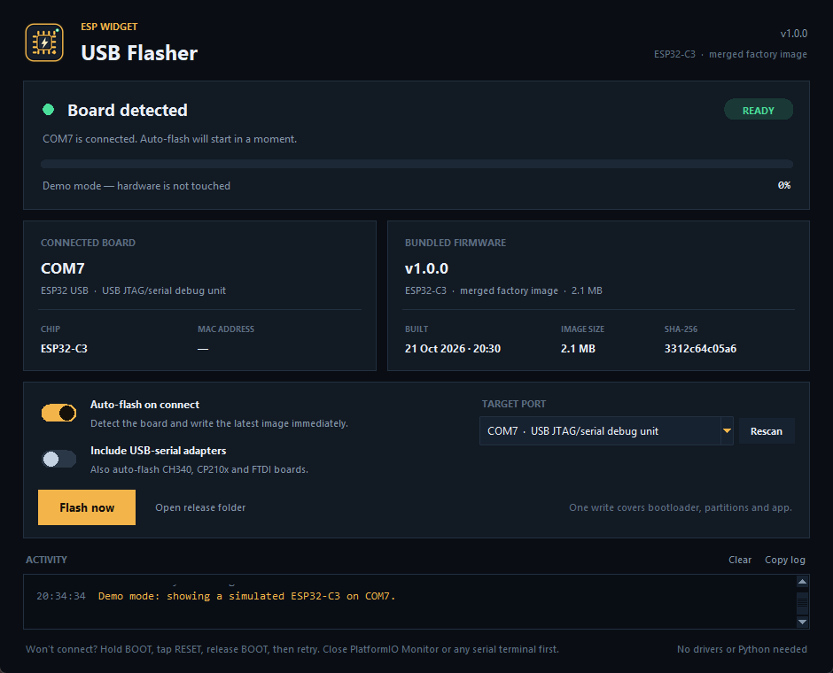
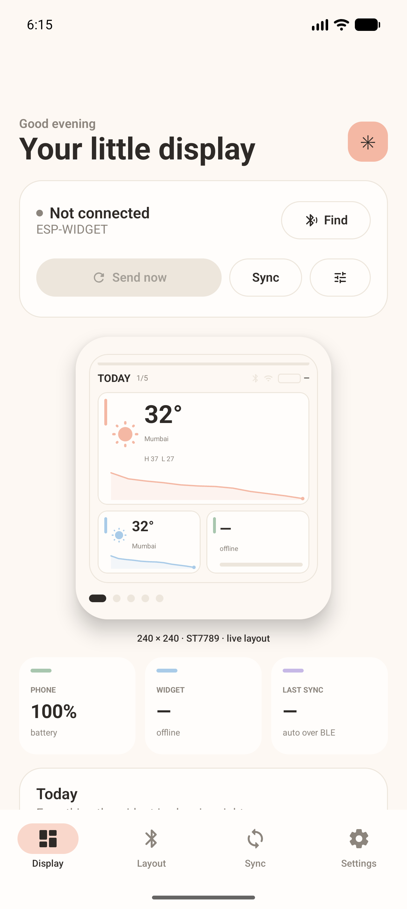
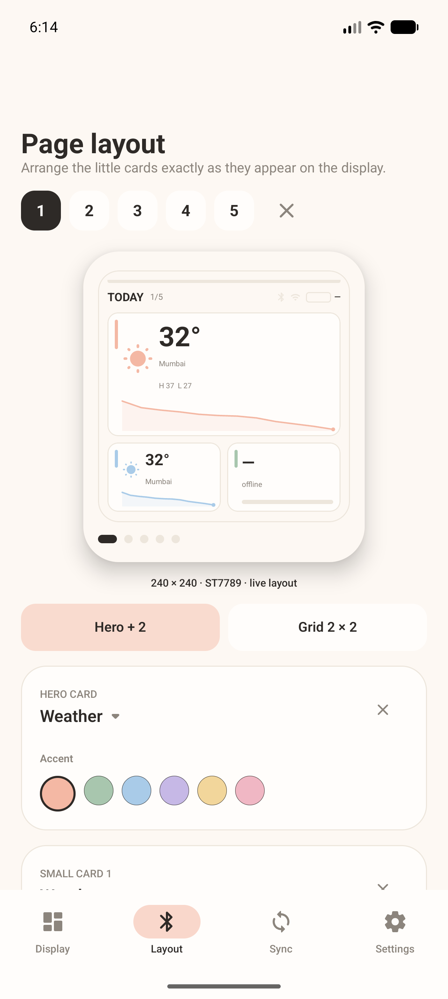
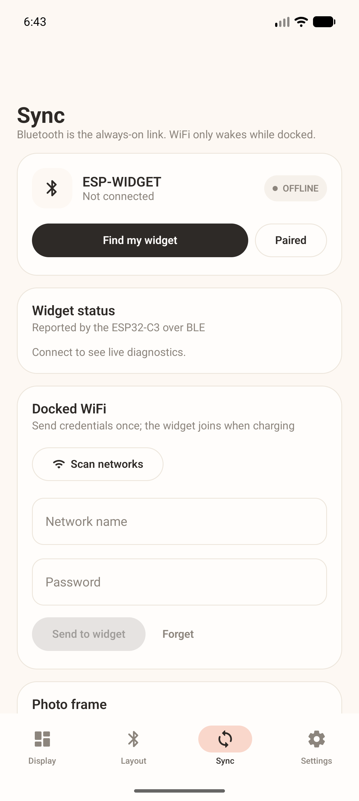
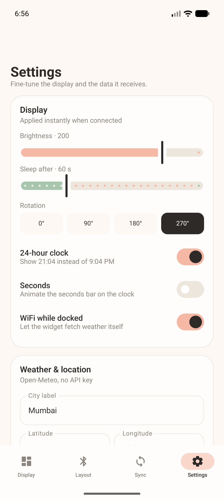
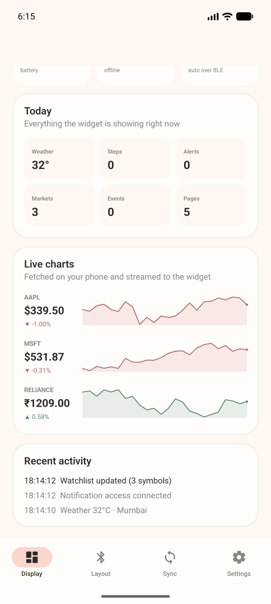
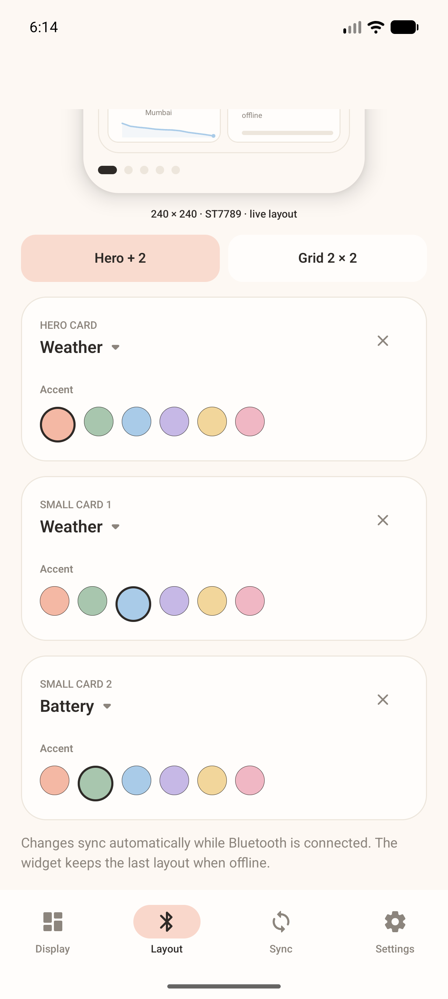
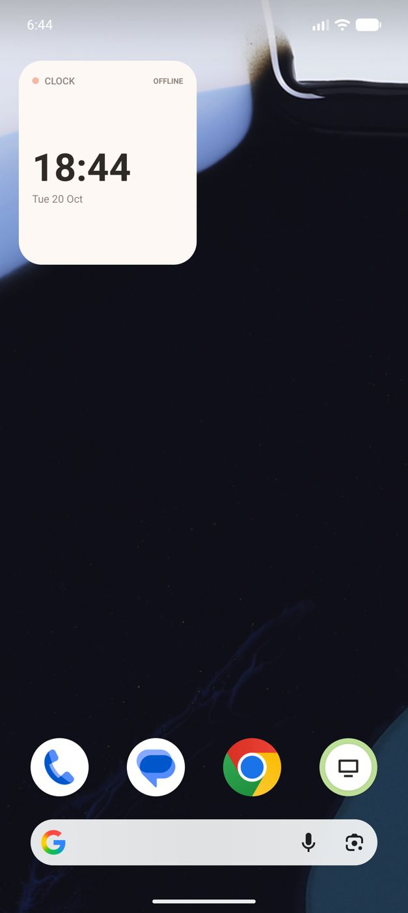

# ESP Widget

A 240 × 240 pastel desk widget on an ESP32-C3, paired with an Android app that keeps it full of the small things worth glancing at: time, weather, battery, markets, notifications, media, calendar, steps, notes and a photo.

The firmware and app share one versioned, CRC-protected BLE protocol. The Android side also ships ten matching home-screen widgets rendered with Jetpack Glance.

## What is in this repository

```
Esp Widget/
├── firmware/                 ESP32-C3 PlatformIO project
│   ├── include/              board pins, display, theme, UI, power, network
│   ├── lib/espw_protocol/    hardware-free wire protocol + native tests
│   ├── src/                  application, BLE, sync, WiFi, widgets
│   └── test/                 Unity protocol tests and generated vectors
├── app/                      Android app (Kotlin, Compose, Glance)
├── flasher/                  Portable Windows USB flasher (Python + Tk)
├── release/                  Firmware image, signed APK, flasher exe
├── protocol/vectors.json     Golden frames shared by both test suites
├── tools/                    Release, font and test-vector generators
├── docs/                     Protocol, hardware and flasher reference
└── screenshots/              Emulator and desktop captures from verification
```

## Firmware

### Hardware

| Signal | GPIO | Notes |
| --- | --- | --- |
| ST7789 SCLK | 6 | SPI2 |
| ST7789 MOSI | 10 | |
| ST7789 RES | 5 | |
| ST7789 DC | 3 | |
| Backlight | 4 | PWM |
| Touch / button | 1 | active high |
| Battery ADC | 0 | 100k + 100k divider, calibrated multiplier |
| TP4056 blue LED | 20 | charge/full sensing |
| TP4056 red LED | 21 | charge/full sensing |

This is the pin table the working Keychain firmware compiles with (`ESPW_PIN_PROFILE=0`). Two older/stale pin tables are selectable with `-DESPW_PIN_PROFILE=1` or `2`; see [docs/HARDWARE.md](docs/HARDWARE.md). The display is a 240 × 240 ST7789 with inversion enabled, driven through LovyanGFX with a sprite canvas.

### Pages and widgets

The display holds up to five pages. Each page is a `Hero + 2` layout (one large card and two small ones) or a `Grid 2 × 2`. All ten widget types work in either position:

- **Clock** — 12/24-hour, optional seconds bar.
- **Weather** — current temperature, condition, high/low, city and a 12-hour hourly trend graph.
- **Battery** — device charge, voltage, charging/full/docked state and a level bar.
- **Stocks** — symbol, price, percent change and a 24-point (one-month) sparkline, fetched on the phone and streamed over BLE.
- **Notifications** — latest app, count, title and body.
- **Now playing** — track, artist, play state and progress.
- **Calendar** — next event with day, time and location.
- **Steps** — daily steps against a goal with a ring.
- **Note** — one of four notes, word-wrapped.
- **Photo** — a 240 × 240 JPEG received over BLE.

The touch pad (or button on GPIO 1) cycles forward through every configured page on each short press, wrapping from the last page back to the first, and a 1.5 s hold opens a five-minute BLE pairing window. A thin battery bar runs across the very top of the display, colour-coded green/butter/red by level. Soft pastel accents (peach, sage, sky, lavender, butter, rose) are selectable per card in the app.

### Build and flash

```bash
cd firmware
pio run                 # build
pio run -t upload       # flash over USB-C
pio device monitor      # 115200 baud
```

The project uses PlatformIO Espressif32 8.0.0, Arduino, LovyanGFX, NimBLE-Arduino and ArduinoJson. A custom 4 MB partition table leaves room for the application and a LittleFS photo partition.

Native protocol tests (no hardware needed):

```bash
cd firmware
pio test -e native
```

### Behaviour

- BLE advertises as `ESP-WIDGET-XXXX` with a passkey display and an encrypted, bonded link. The service and characteristics are in [docs/PROTOCOL.md](docs/PROTOCOL.md).
- On battery the display dims after 20 s and deep-sleeps after the configured timeout, waking on the touch pin. Charging keeps it awake.
- WiFi is off on battery. When docked and enabled, the widget joins the stored network, syncs NTP and refreshes weather from Open-Meteo. The phone can send credentials and request a scan over BLE.
- The last layout, settings, notes, WiFi credentials, location and weather live in NVS and survive a reset. A factory-reset message clears them and the Bluetooth bonds.

## Desktop USB flasher

`release\desktop\ESPWidgetFlasher.exe` is a portable Windows app that writes the
complete firmware over the widget's USB-C cable. It embeds esptool and the
merged factory image, so the PC needs no Python, PlatformIO or Arduino IDE.



1. Open the exe.
2. Leave **Auto-flash on connect** on.
3. Plug in the board. The app detects the ESP32-C3, writes the bootloader,
   partition table and app, verifies the data, and restarts the widget.

The port, chip, MAC, firmware version, image size and SHA-256 are shown in the
window, with a live esptool log underneath. **Flash now** works manually if
auto-detection is off, and **Include USB-serial adapters** adds CH340, CP210x
and FTDI bridges. If the board will not enter download mode, hold **BOOT**, tap
**RESET**, release **BOOT**, then retry.

See [docs/FLASHER.md](docs/FLASHER.md) for port rules, troubleshooting and the
manual build commands.

### Build the full release

From the repository root:

```powershell
cd "C:\Users\Gourav\Documents\Random Projects\Esp Widget"
powershell -NoProfile -ExecutionPolicy Bypass -File .\tools\build_release.ps1
```

That rebuilds the firmware, merges the factory image, signs the Android release
APK with the local keystore, packages the portable exe, runs its self-test and
writes `release\SHA256SUMS.txt`.

## Android app

### Build

Requirements: JDK 17+ (Android Studio's JBR works), Android SDK 35, connected device or emulator running API 26+.

```bash
cd app
# create local.properties with sdk.dir=/absolute/path/to/Android/Sdk
./gradlew :app:assembleDebug
./gradlew :app:testDebugUnitTest
adb install -r app/build/outputs/apk/debug/app-debug.apk

# Signed release (reads app/keystore.properties when present)
./gradlew :app:assembleRelease
adb install -r app/build/outputs/apk/release/app-release.apk
```

If the debug build is already installed, uninstall it once before installing the
release APK; the two use different signing keys.

The app requests Bluetooth scan/connect, notifications, activity recognition, calendar and location permissions when they are needed. Notification mirroring and media metadata additionally require Notification access (Settings → Permissions → Notification access).

### What it does

- **Display** — a faithful 240 × 240 preview of the current page (including its top battery bar and page dots), connection state, phone/widget battery, a live-chart strip for the watchlist and a one-tap manual sync.
- **Layout** — page picker, add/remove pages, template switch, per-slot widget picker, watchlist/note option, accent palette. Every change is pushed automatically over BLE.
- **Sync** — scan/connect, encrypted link status, firmware/battery/heap/uptime diagnostics, docked-WiFi scan and credentials, photo transfer, four notes, activity log and factory reset.
- **Settings** — brightness, sleep, rotation, 12/24-hour, seconds, docked WiFi; weather location and refresh interval; stock symbols; step goal; calendar look-ahead; permission shortcuts; widget pinning.
- **Background** — a sticky foreground service keeps the link alive, the app restarts it after reboot, and a notification listener plus media-session reader feed the relevant cards.
- **Data** — Open-Meteo weather (phone-side, no API key), Yahoo Finance chart quotes, Android calendar, media sessions, step counter, battery broadcasts and notifications.

The ten Glance home-screen widgets mirror the hardware cards: Clock, Weather, Battery, Markets, Alerts, Now Playing, Calendar, Steps, Note and Photo. Pin them from Settings or the launcher's widget picker.

### Screenshots

| Display | Layout |
| --- | --- |
|  |  |

| Sync | Settings |
| --- | --- |
|  |  |

| Live charts from the phone | Layout editor |
| --- | --- |
|  |  |



## Protocol in one paragraph

Every message is a little-endian frame: `E W 01 type flags seq:u16 len:u16 payload crc16:u16`, where the CRC is CCITT-FALSE over bytes 2..end-of-payload. Frames larger than the BLE MTU are split into `[0xF1][frameId][part][count][reserved][data]` chunks; the first chunk carries the frame header and later chunks can arrive out of order. The full table, payload layouts, acknowledgements and transfer flow are in [docs/PROTOCOL.md](docs/PROTOCOL.md), with golden frames in [protocol/vectors.json](protocol/vectors.json).

## Verified

- Firmware builds successfully for `esp32-c3-devkitm-1` (85.1% flash, 16.0% RAM at the time of writing).
- Six firmware Unity tests pass on the `native` environment.
- Ten Kotlin unit tests pass against the same golden vectors (framing, CRC, fragmentation/reassembly, packed payloads, chart payloads).
- The signed release APK builds and verifies with `apksigner`; the debug APK installs and runs on a 1280 × 2856 API 37 emulator. Display, Layout, Sync and Settings screens were captured, and a Clock Glance widget was pinned and rendered. See [screenshots/](screenshots/).
- The portable flasher passes 22 Python unit tests (including the auto-flash state machine), its packaged `--self-test`, and a GUI smoke test. Its embedded image matches the release manifest SHA-256.

## Limitations

- No physical ESP32-C3 was attached during verification, so real BLE pairing, touch, battery calibration, WiFi association, the panel itself and a real USB-C flash are unverified on hardware. The flasher's image layout, esptool invocation, error paths and packaged runtime were tested without a board.
- The portable flasher is not code-signed, so Windows SmartScreen may ask for confirmation on first launch. The Android release is signed with a locally generated keystore in `app/keystore/`; keep `app/keystore.properties` and that JKS to install future updates.
- The flasher targets ESP32-C3 only and intentionally refuses other chips.
- Photo transfer is intentionally small (≤ 40 KB, 240 × 240 JPEG) because BLE throughput is the bottleneck. At the default 23-byte MTU the sender automatically reduces each photo chunk to stay within the 32-fragment limit.
- Media and notification data need Notification access. Step data needs a hardware step counter and the activity-recognition permission.
- Stock quotes come from Yahoo Finance's public chart endpoint; coverage and delay depend on the symbol suffix (`.US` → US ticker, `.IN` → NSE, anything else passed through).
- The phone and widget sync over BLE. WiFi on the widget is used for NTP and weather, not for phone-to-widget file transfer.
- The `Keychain` project this was derived from was left untouched.
